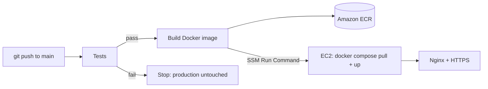

# GitHub Actions → AWS EC2 deploy (no stored AWS keys)

A ready-to-use pipeline: every push to `main` **tests**, **builds a Docker image**, pushes it to **Amazon ECR** and
**deploys it to an EC2 instance through AWS Systems Manager**. GitHub signs in to AWS with an **IAM role (OIDC)**, so
there are no AWS access keys in your repository or in GitHub secrets.

## What's inside
| Path | Purpose |
|---|---|
| `.github/workflows/deploy.yml` | The pipeline (off until you set `DEPLOY_ENABLED=true`) |
| `aws/github-oidc-trust-policy.json` | Lets only your repo's `main` branch assume the deploy role |
| `aws/deploy-role-permissions.json` | Least-privilege permissions: push to one ECR repo, run SSM on one instance |
| `server/ec2-setup.sh` | Installs Docker, Nginx and Certbot on Ubuntu |
| `server/docker-compose.yml` | Runs your image on the instance, listening on localhost only |
| `server/nginx-app.conf` | Reverse proxy; add HTTPS with Certbot |
| `examples/Dockerfile.*` | Starting points for Django and Node / Next.js |

## Setup (about 30 minutes)
1. **AWS: OIDC provider.** IAM → Identity providers → add `token.actions.githubusercontent.com`, audience `sts.amazonaws.com`.
2. **AWS: deploy role.** Create a role with `aws/github-oidc-trust-policy.json` (replace `ACCOUNT_ID` and `OWNER/REPO`)
   and attach `aws/deploy-role-permissions.json` (replace `REGION`, `ACCOUNT_ID`, `REPOSITORY`, `INSTANCE_ID`).
3. **AWS: ECR repository** for your image, and an **EC2 instance** (Ubuntu) with an instance role that has
   `AmazonSSMManagedInstanceCore` and ECR read access. Run `server/ec2-setup.sh` on it and put
   `server/docker-compose.yml` plus your app's `.env` in `/opt/app`.
4. **GitHub: secret** `AWS_DEPLOY_ROLE` = the role ARN (Settings → Secrets and variables → Actions → Secrets).
5. **GitHub: variables** (same page → Variables): `AWS_REGION`, `ECR_REPOSITORY`, `EC2_INSTANCE_ID`, optionally `APP_DIR`,
   and finally `DEPLOY_ENABLED` = `true`.
6. **Optional approval:** Settings → Environments → `production` → add yourself as a required reviewer.
7. Pick your stack's test block in `deploy.yml`, copy the matching `examples/Dockerfile.*` to `Dockerfile`, and push.

## Rollback
Actions → the last green run → **Re-run all jobs**. The previous image goes live again.

## Security notes
- No AWS keys anywhere: short-lived credentials through OIDC, limited to your repo's `main` branch.
- The deploy role can only push to one ECR repository and run commands on one instance.
- The app listens on `127.0.0.1`; only Nginx (80/443) is public. Keep SSH closed or limited to your IP.

## Want this set up for you?
I set up this pipeline for clients, adapted to their app and AWS account, with a test deploy and a handover runbook:
**[GitHub Actions CI/CD to AWS on Fiverr](https://www.fiverr.com/abidaslam892/prepare-project-pipelines-and-plan)**.
Need the app deployed on AWS first? **[AWS app deployment](https://www.fiverr.com/abidaslam892/professional-aws-cloud-deployment)**.

## License
MIT
